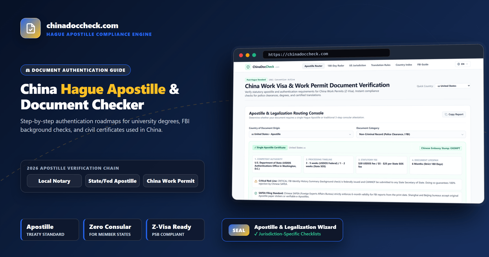
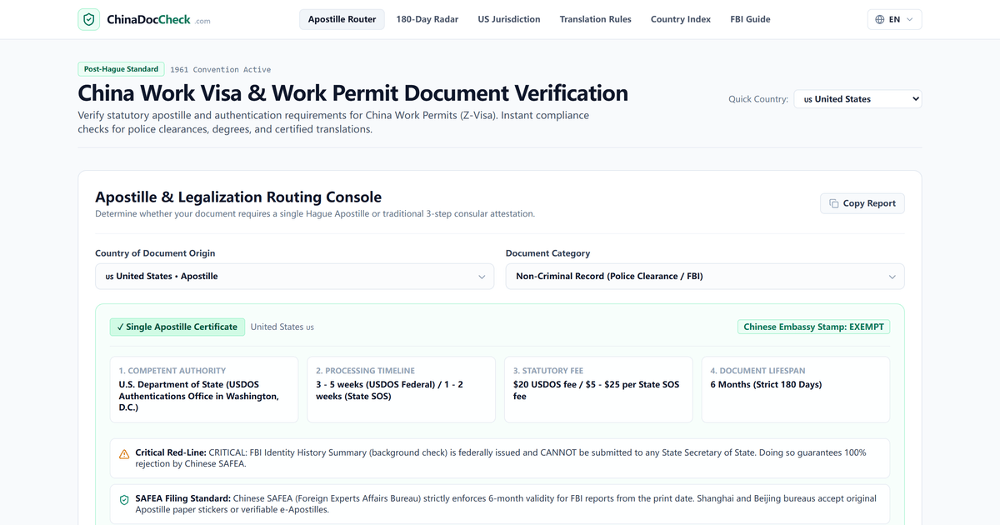
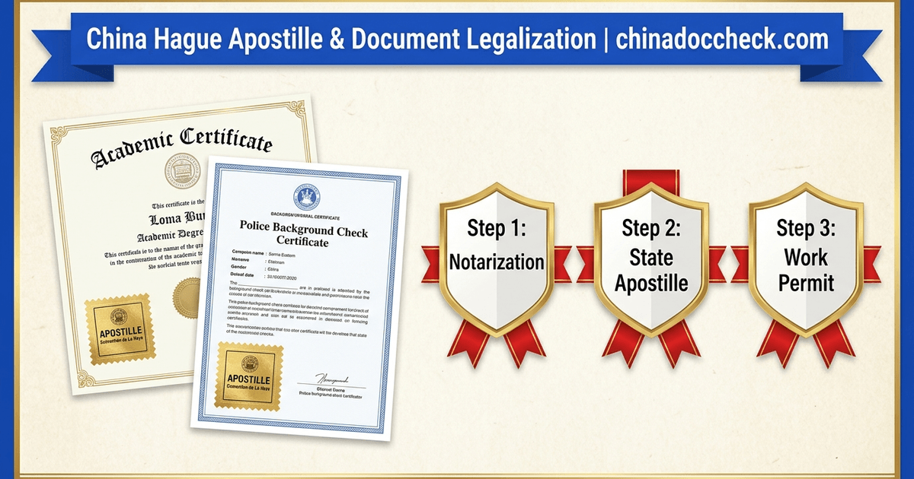

# ChinaDocCheck MCP Server — 16-Country China Hague Apostille, USDOS Jurisdiction & 180-Day Validity Engine



## Overview & Production Architecture

**ChinaDocCheck** ([https://chinadoccheck.com](https://chinadoccheck.com)) exposes a stateless, zero-authentication **Model Context Protocol (MCP)** server (`streamable-http` at `https://chinadoccheck.com/api/mcp`) engineered for China Z-Visa work permit and dependent visa compliance following China's accession to the Hague Apostille Convention. Backed directly by 16 national authentication dossiers, 10 U.S. state Secretary of State vs Federal USDOS routing rules, a deterministic **180-day police check validity radar**, mainland **SAFEA `翻译专用章` (Translation Special Seal)** & **Remote Online Notarization (RON)** rules, high-frequency RFE diagnostics, and 6 native-script country guides (`ja, ko, de, fr, ru, es`), all 8 tools are public and annotated `readOnlyHint: true` with no API keys required.



## Available MCP Tools (8 Read-Only Tools)

| Tool Name | Purpose & Deterministic Engine | Key Parameters | Safety |
| :--- | :--- | :--- | :---: |
| `route_country_apostille_and_legalization_authority` | Match applicant issuing country and certificate category against 16 national authentication profiles to identify federal vs provincial Apostille  | `countryQuery`*, `documentTypeId` | `readOnly` |
| `calculate_180day_document_validity_radar` | Measure elapsed calendar days since police check issuance, deduct DHL courier and SAFEA bureau review buffers, and classify net safe filing windo | `issueDate`*, `asOfDate`, `shippingBufferDays`, `safeaReviewBufferDays` | `readOnly` |
| `check_us_federal_vs_state_apostille_jurisdiction` | Prevent automatic Chinese work permit rejection by matching U.S. FBI checks, university diplomas, TEFL certificates, or state police clearances t | `docCategory`*, `stateCode`, `notaryMethod` | `readOnly` |
| `inspect_country_deep_legalization_dossier` | Retrieve comprehensive stage-by-stage authentication timelines, fingerprint requirements, Tier-1 municipal enforcement nuances, and printable fil | `countryQuery`*, `includeCityNuances` | `readOnly` |
| `audit_safea_translation_and_remote_notary_compliance` | Verify whether a translation package satisfies PRC mainland corporate dual-seal mandates and evaluate Shanghai, Beijing, GBA, and Tier-2 city acc | `translatorCountry`, `hasTranslationSpecialSeal`, `hasBusinessLicenseCopy`, `targetCity` | `readOnly` |
| `diagnose_zvisa_document_rejection_risks` | Screen an applicant filing configuration against documented high-frequency SAFEA RFE triggers including mismatched state/federal apostilles, expi | `countryCode`, `submittedFbiToStateSos`, `openedSealedPoliceEnvelope`, `koreaCheckPurpose` | `readOnly` |
| `retrieve_multilingual_police_clearance_guide` | Fetch complete native-language SAFEA criminal record and Apostille instructions, timelines, RFE case studies, and FAQs in Japanese, Korean, Germa | `locale`* | `readOnly` |
| `generate_printable_visa_dossier_checklist` | Assemble an ordered end-to-end document authentication checklist tailored by home country and visa role (Standard Z-Visa, ESL Teacher, S1/S2 Depe | `countryQuery`*, `applicantRole`* | `readOnly` |

## Live JSON-RPC 2.0 Verification Sample

Request (`POST https://chinadoccheck.com/api/mcp`):

```bash
curl -s -X POST https://chinadoccheck.com/api/mcp \
  -H "Content-Type: application/json" \
  -d '{"jsonrpc":"2.0","id":1,"method":"tools/call","params":{"name":"calculate_180day_document_validity_radar","arguments":{"issueDate":"2026-08-01","asOfDate":"2026-11-20","shippingBufferDays":10,"safeaReviewBufferDays":15}}}'
```

Verified Production Response:

```json
{
  "sourceEngine": "components/tools/ValidityRadarWidget.tsx (SAFEA 180-Day Countdown)",
  "asOfDate": "2026-11-20",
  "hardExpiryDate": "2027-01-28",
  "issueDate": "2026-08-01",
  "daysElapsed": 111,
  "daysRemaining": 69,
  "shippingBufferDays": 10,
  "safeaReviewBufferDays": 15,
  "netWorkingDaysRemaining": 44,
  "status": "warning",
  "statusText": "Urgent Processing Window",
  "advice": "Urgent: Standard mail-in Apostille risks exhaustion. Use expedited courier and book mainland certified Chinese translation concurrently.",
  "calculatorUrl": "https://chinadoccheck.com/validity-calculator"
}
```

## Quick Client Configuration (Claude Desktop / Cursor / Windsurf / Hermes)

```json
{
  "mcpServers": {
    "chinadoccheck": {
      "type": "streamable-http",
      "url": "https://chinadoccheck.com/api/mcp"
    }
  }
}
```

Or run directly from any Node.js terminal via the pinned official CLI:

```bash
npx -y chinadoccheck-cli@1.0.0 tools
npx -y chinadoccheck-cli@1.0.0 demo
```

## Statutory Compliance, Jurisdiction & Validity Matrices

### 16-Country China Hague Apostille vs Consular Legalization Routing Matrix

| Code | Jurisdiction | Convention Status | Procedure Type | Typical Timeline | Official Fee |
| :---: | :--- | :---: | :--- | :--- | :--- |
| `US` | **[United States](https://chinadoccheck.com/countries/united-states)** | Hague Member (2023-11-07) | Apostille | 3 - 5 weeks (USDOS Federal) / 1 - 2 weeks (State SOS) | $20 USDOS fee / $5 - $25 per State SOS fee |
| `GB` | **[United Kingdom](https://chinadoccheck.com/countries/united-kingdom)** | Hague Member (2023-11-07) | Apostille | 5 - 10 working days (standard FCDO) / 2 business days (urgent business service) | £45 standard paper Apostille / £35 e-Apostille |
| `JP` | **[Japan](https://chinadoccheck.com/countries/japan)** | Hague Member (2023-11-07) | Apostille | 1 - 5 business days (MOFA Counter: Next-day; Mail: ~1 week) | Free statutory MOFA fee (¥0) |
| `KR` | **[South Korea](https://chinadoccheck.com/countries/south-korea)** | Hague Member (2023-11-07) | Apostille | 1 - 3 business days (MOFA Consular Service Center in Seoul) / Instant via e-Apostille | ₩1,000 KRW statutory fee per document (Counter) / Free (e-Apostille) |
| `CA` | **[Canada](https://chinadoccheck.com/countries/canada)** | Hague Member (2024-01-11) | Apostille | 10 - 25 business days (Provincial) / 4 - 8 weeks (Global Affairs Canada) | Free (Global Affairs Canada) or $16 - $40 CAD per provincial document |
| `AU` | **[Australia](https://chinadoccheck.com/countries/australia)** | Hague Member (2023-11-07) | Apostille | 3 - 7 business days via DFAT mail/in-person | $98 AUD per document (DFAT standard statutory fee) |
| `PK` | **[Pakistan](https://chinadoccheck.com/countries/pakistan)** | Non-Hague / Consular | Consular Legalization | 6 - 8 weeks (Requires strict 3-tier sequence) | Varies: HEC + MOFA + Chinese Embassy Consular fee (~$70 - $110 USD) |
| `IN` | **[India](https://chinadoccheck.com/countries/india)** | Hague Member (2023-11-07) | Apostille | 10 - 20 working days via MEA outsourced centers | ₹50 statutory MEA fee + VFS/agency service charge |
| `ES` | **[Spain](https://chinadoccheck.com/countries/spain)** | Hague Member (2023-11-07) | Apostille | 1 - 3 business days (Electronic or in-person) | Free (Gerencia Territorial) or ~€18 - €30 (Colegio Notarial) |
| `DE` | **[Germany](https://chinadoccheck.com/countries/germany)** | Hague Member (2023-11-07) | Apostille | 2 - 4 weeks | €20 - €40 per document |
| `RU` | **[Russia](https://chinadoccheck.com/countries/russia)** | Hague Member (2023-11-07) | Apostille | 5 - 30 business days (MVD Police Clearance: ~5 days; Rosobrnadzor Diploma: 30 - 45 days) | 2,500 RUB state duty per document |
| `FR` | **[France](https://chinadoccheck.com/countries/france)** | Hague Member (2023-11-07) | Apostille | 1 - 3 weeks | Free (Court of Appeal) or nominal processing charges |
| `ZA` | **[South Africa](https://chinadoccheck.com/countries/south-africa)** | Hague Member (2023-11-07) | Apostille | 4 - 8 weeks due to DIRCO queue (rush expediter advised) | Free statutory DIRCO fee (courier/agent fees separate) |
| `AE` | **[United Arab Emirates](https://chinadoccheck.com/countries/united-arab-emirates)** | Non-Hague / Consular | Consular Legalization | 3 - 5 weeks (Consular Legalization) | AED 150 (MOFA) + AED 160 (Chinese Consular legalization fee) |
| `SG` | **[Singapore](https://chinadoccheck.com/countries/singapore)** | Hague Member (2023-11-07) | Apostille | 1 - 3 business days | SGD $10.70 per SAL apostille stamp |
| `PH` | **[Philippines](https://chinadoccheck.com/countries/philippines)** | Hague Member (2023-11-07) | Apostille | 5 - 12 working days | PHP 100 (standard) / PHP 200 (expedited) |

### U.S. Federal USDOS vs State Secretary of State Jurisdiction & RON Rules

| U.S. Document Category | Statutory Issuing Level | Competent Apostille Authority | Remote Online Notarization (RON) Risk & Compliance Rule |
| :--- | :---: | :--- | :--- |
| **FBI Identity History Summary** | **`FEDERAL`** | **USDOS Office of Authentications** (Washington, D.C. / Sterling, VA · `Form DS-4194`) | **HIGH (Prohibited)**: Federal record cannot be state-notarized or apostilled by a State SOS; USDOS rejection if routed to a state office |
| **University Degree / Diploma** | **`STATE`** | **State Secretary of State** where the university is legally chartered | **MEDIUM (Home-State Safer)**: Shanghai, Beijing, and Shenzhen SAFEA bureaus have questioned out-of-state RON notarizations on diplomas |
| **State Bureau Criminal Record** | **`STATE`** | **State Secretary of State** matching the state police agency | **HIGH (Official Seal Mandatory)**: Must carry the ink/digital seal of the state bureau of investigation or court registrar |
| **Online TEFL / TESOL / CELTA** | **`STATE`** | **State Secretary of State** (e.g., notarized true copy in CA, NY, TX, FL, WA, IL, PA, MA, VA, GA) | **LOW**: Online ESL certificates generally pass with standard notarization + Secretary of State Apostille |

### SAFEA 180-Day Police Clearance Validity Radar & Mainland Translation Seal Mandate

| Compliance Dimension | Code-Verified Threshold / Statutory Requirement | Failure Trigger & Remediation Action |
| :--- | :--- | :--- |
| **Safe Filing Window (`safe`)** | `daysRemaining > 90` and `netWorkingDaysRemaining > 25` after subtracting DHL + SAFEA buffers | Standard Hague Apostille and mainland certified translation fit within 180-day statutory cap |
| **Urgent Window (`warning`)** | `30 <= daysRemaining <= 90` or `6 <= netWorkingDaysRemaining <= 25` | Book expedited courier and mainland certified Chinese translation concurrently |
| **Critical Window (`critical`)** | `daysRemaining < 30` or `netWorkingDaysRemaining <= 5` | High probability of expiration during SAFEA review; request a fresh police clearance immediately |
| **Expired Window (`expired`)** | `daysRemaining <= 0` (exceeds 180 calendar days from certificate issue date) | Automatic SAFEA work permit portal rejection; a newly issued police certificate is mandatory |
| **Chinese Translation Dual-Seal** | Registered mainland China translation agency with PSB-filed **翻译专用章** (Translation Special Seal) + stamped Business License copy | Overseas agencies or applicant self-translations are rejected nationwide by mainland SAFEA bureaus |

## Technical Architecture & Editorial Reference



## Official Web Tools & Country Legalization Guides

- **[ChinaDocCheck Official Portal — China Work Visa Apostille & Legalization Matrix](https://chinadoccheck.com)** — `https://chinadoccheck.com`
- **[16-Country China Hague Apostille vs Consular Legalization Directory](https://chinadoccheck.com/countries)** — `https://chinadoccheck.com/countries`
- **[180-Day SAFEA Police Check Validity & Buffer Calculator](https://chinadoccheck.com/validity-calculator)** — `https://chinadoccheck.com/validity-calculator`
- **[U.S. Federal USDOS vs 10-State Secretary of State Jurisdiction Checker](https://chinadoccheck.com/us-jurisdiction)** — `https://chinadoccheck.com/us-jurisdiction`
- **[SAFEA Certified Chinese Translation Seal (翻译专用章) & Formatting Standards](https://chinadoccheck.com/translation-standards)** — `https://chinadoccheck.com/translation-standards`
- **[FBI Identity History Summary Apostille for China Z-Visa Guide](https://chinadoccheck.com/fbi-background-check-china)** — `https://chinadoccheck.com/fbi-background-check-china`
- **[United States Document Authentication & USDOS Form DS-4194 Guide](https://chinadoccheck.com/countries/united-states)** — `https://chinadoccheck.com/countries/united-states`
- **[United Kingdom FCDO Apostille & ACRO Police Certificate Guide for China](https://chinadoccheck.com/countries/united-kingdom)** — `https://chinadoccheck.com/countries/united-kingdom`
- **[Canada Global Affairs Hague Apostille & RCMP Criminal Record Guide](https://chinadoccheck.com/countries/canada)** — `https://chinadoccheck.com/countries/canada`
- **[Australia DFAT Apostille & AFP National Police Check Guide for China](https://chinadoccheck.com/countries/australia)** — `https://chinadoccheck.com/countries/australia`

## License

MIT License — maintained by **[ChinaDocCheck](https://chinadoccheck.com)**.
